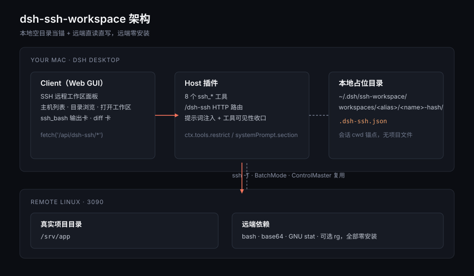
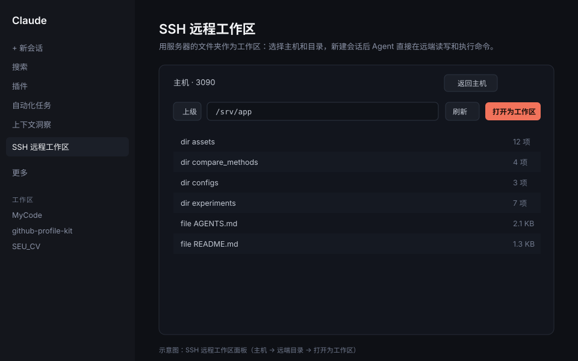
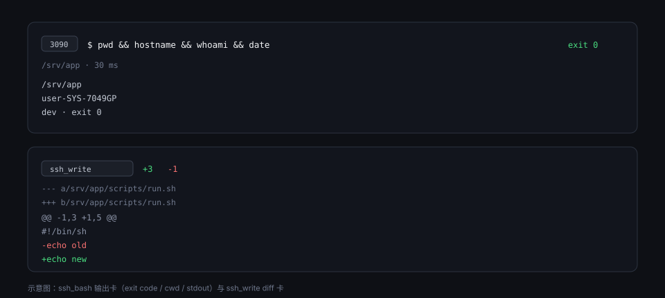

# dsh-ssh-workspace

> 在 DeepSeek Harness (DSH) 里，把 SSH 服务器上的文件夹当作工作区。文件读写直接发生在远端，服务器上不需要安装任何东西。
>
> Open a folder on an SSH host as a native DSH workspace. Reads and writes go straight to the server: there is no local mirror or sync step, and nothing needs to be installed on the remote.

[](LICENSE)
[](https://github.com/C6oisini/dsh-ssh-workspace/actions/workflows/test.yml)
[](#要求)



## 工作原理

DSH 的会话以本地目录（`cwd`）标识工作区，远端路径没法直接当 `cwd`。插件的做法：

1. 在 `~/.dsh/ssh-workspace/workspaces/` 下建一个空的占位目录，里面放一个自描述的 `.dsh-ssh.json`；
2. 用 DSH 原生工作区 API 注册这个占位目录，并把它作为新会话的工作目录；
3. 会话启动时启用一组 `ssh_*` 工具，同时隐藏内置的本地文件和命令工具（`read`、`write`、`edit`、`apply_patch`、`read_image`、`bash`、`glob`、`grep`），避免 Agent 在空占位目录里读写；
4. 所有操作经系统 `ssh` 在服务器上执行，本地不落任何项目文件。

会话列表、恢复、标题、侧栏和工具卡都走 DSH 原生实现，插件只换了工具执行的传输层。

## 和 dsh-remote 的区别

| | dsh-ssh-workspace（本项目） | dsh-remote |
|---|---|---|
| 数据模型 | 本地只放占位目录，远端直读直写 | 远端目录镜像到本地，`rw_sync` 同步 |
| 延迟 | 每次工具调用一次 SSH 往返（ControlMaster 复用连接） | 本地文件系统延迟，同步另算 |
| 本地磁盘 | 几乎为 0 | 等于项目大小 |
| 冲突 | 远端是唯一副本 | 镜像与远端可能分叉 |
| 典型场景 | 远端改代码、跑命令、看输出 | 离线编辑大仓库、IDE 体验 |

两者可以装在同一份 DSH 里共存；本项目不占用 dsh-remote 的目录选择槽位。

## 要求

- 本机：macOS 或 Linux，装有系统 `ssh` 客户端；DSH Desktop 0.2.x。
- 远端：Linux + `bash` + GNU coreutils（用到 `base64`、`stat`、`head`、`wc`、`mv`、`chmod`）。不支持远端 macOS/BSD 与 Windows。
- 认证：只支持公钥（`~/.ssh/config`、`ssh-agent` 或 `IdentityFile`）。不支持密码和键盘交互认证。
- host key：插件以 `BatchMode=yes` 连接，不会交互确认。第一次连某台主机前，先手动 `ssh <alias>` 一次，把 host key 写入 `known_hosts`，否则连接直接失败。

远端不需要安装任何东西，也不需要 `sftp`、`rsync` 或 `zsh`。

## 安装

DSH 0.2.x 没有独立的插件安装 CLI（`dsh plugin` 只是转发 pnpm）。用 DSH 自带的 `plugin_manager` 工具安装 bundle 目录：

```bash
git clone https://github.com/C6oisini/dsh-ssh-workspace.git ~/MyCode/dsh-ssh-workspace
```

然后在 DSH 会话里让 Agent 执行（绝对路径）：

```text
plugin_manager install_bundle /Users/<you>/MyCode/dsh-ssh-workspace
```

安装成功后 `application` 为 `applied`、`warnings` 为空；profile 的 `package.json` 会出现 `link:` 依赖，`dsh.profile.bundles` 末尾多出 `dsh-ssh-workspace`。

刷新 GUI（桌面版 `Cmd+R`），左栏图标列表底部会出现「SSH 远程工作区」。

- 更新代码后，先 `plugin_manager remove_bundle dsh-ssh-workspace`，再 `install_bundle`（Host 代码只在重启时加载）。Client 制品刷新页面即可。
- 卸载：`plugin_manager remove_bundle dsh-ssh-workspace`。远端文件不受影响；本地 `~/.dsh/ssh-workspace/` 可手动删除。

## 使用



1. 打开左栏「SSH 远程工作区」面板。主机列表来自 `~/.ssh/config`（跳过 `Host *` 通配）。
2. 选主机，点「浏览」进入远端目录。路径栏可以直接输入绝对路径，回车跳转；`~` 表示家目录。
3. 点「打开为工作区」：插件建占位目录、注册原生工作区、打开新会话。
4. 在新会话里让 Agent 改文件、跑命令。写入和编辑的卡片会显示 unified diff，`ssh_bash` 卡片显示命令、退出码、远端 cwd、耗时和输出。
5. 面板下方列出已打开的工作区，可以重新打开或移除（只删本地占位目录，不碰远端文件）。

会话启动时，插件读取远端项目根目录的 `AGENTS.md` / `CLAUDE.md` 并注入系统提示词；修改后需要新会话才生效。

## 工具

| 工具 | 说明 |
|---|---|
| `ssh_read` | 读文本文件（最多 512KB；含 NUL 视为二进制并拒绝）。给模型的正文截到 60KB。 |
| `ssh_write` | 覆盖写整个文件，返回 unified diff。保留原权限位；目标是符号链接时写到链接目标（链接本身保留）。 |
| `ssh_edit` | 唯一匹配替换；保留 CRLF。文件超过 512KB 时拒绝，避免把截断副本写回去丢尾部。 |
| `ssh_ls` | 列目录（省略路径 = 工作区根；支持 `~`）。 |
| `ssh_stat` | 文件类型、大小、mtime、权限位。 |
| `ssh_glob` | bash `globstar` 匹配，最多 300 条。 |
| `ssh_grep` | 优先 `rg`，没有则 `grep -rn -I -E`，最多 200 行。 |
| `ssh_bash` | 在远端工作区根目录跑 `bash -l`，返回 stdout/stderr、退出码、耗时；超时可配。 |



## 工作区是怎么表示的

```
~/.dsh/ssh-workspace/workspaces/<alias>/<basename>-<hash>/.dsh-ssh.json
```

`.dsh-ssh.json` 记录 `{ version, alias, remotePath, hostname, user, port }`。DSH 会话的 `cwd` 就是这个占位目录，插件从 `cwd` 向上找到绑定文件，反推远端主机与路径，所以 DSH 重启、会话恢复后绑定依然有效。

- 占位目录里除 `.dsh-ssh.json` 外没有项目文件，远端文件不镜像。
- 删除占位目录等于遗忘这个工作区。面板里的「移除」会做校验，只删 `~/.dsh/ssh-workspace/workspaces/` 之内的目录。
- ControlMaster socket 放在 `~/.dsh/ssh-workspace/cm/`，`ControlPersist=300` 秒。

## 安全模型

- `ssh_bash` 以 SSH 账号权限直接执行，没有二次确认、没有远端沙箱、没有命令白名单。风险边界等同于你用该账号登录服务器。
- 插件不读取、不保存私钥；认证交给系统 `ssh` 和 `~/.ssh/config`。
- 只信任 `known_hosts`。`BatchMode=yes` 下，未知 host key 直接失败。
- 远端 `AGENTS.md` / `CLAUDE.md` 会进入系统提示词，只打开你信任的仓库。
- 远端会话里看不到内置的本地文件和命令工具，读写都走 `ssh_*`；这些工具只对占位目录内的会话生效。
- 工具输出给模型前截到 60KB，避免撑爆上下文。diff 源文件超过 4000 行或 LCS 单元格超过 4,000,000 时，退化为整文件摘要。

## 已知限制

- 远端仅支持 Linux（bash + GNU coreutils），暂不支持远端 macOS/BSD/Windows。
- 仅公钥认证；密码与键盘交互认证会直接失败。
- v1 不做终端面板、端口转发、git 面板、上传下载。
- 没有远端文件锁：两个会话同时写同一文件，后写覆盖。
- DSH 的 rewind 只回滚本地工作区状态，不会回滚远端文件。
- `~/.ssh/config` 的 `ProxyJump` / `ProxyCommand` 会生效（连接走 alias），但面板只展示 `HostName`。
- 面板不解析 `Match` 块；被 `Match` 限定的主机可能显示不全（连接仍由系统 `ssh` 决定）。
- 超大文件的 diff 退化为行数摘要；`ssh_edit` 对超过 512KB 的文件直接拒绝。
- 客户端 API 依赖 DSH 的半内部接口（`workspaces` / `uiWorkspace` / `slots` / `layout`），DSH 0.3 可能不兼容。

## 开发

无运行时依赖（Node 内建模块 + 系统 `ssh`）。

```bash
npm run check     # node --check 全部源码
npm test          # node --test test/*.test.js
```

测试不连接 SSH：diff 算法、工具 JSON Schema、绑定目录和 `~/.ssh/config` 解析都用临时目录与假配置。

CI 在 GitHub Actions 上跑同样的检查：Ubuntu / macOS × Node 20 / 22 / 24。

## License

[MIT](LICENSE)
